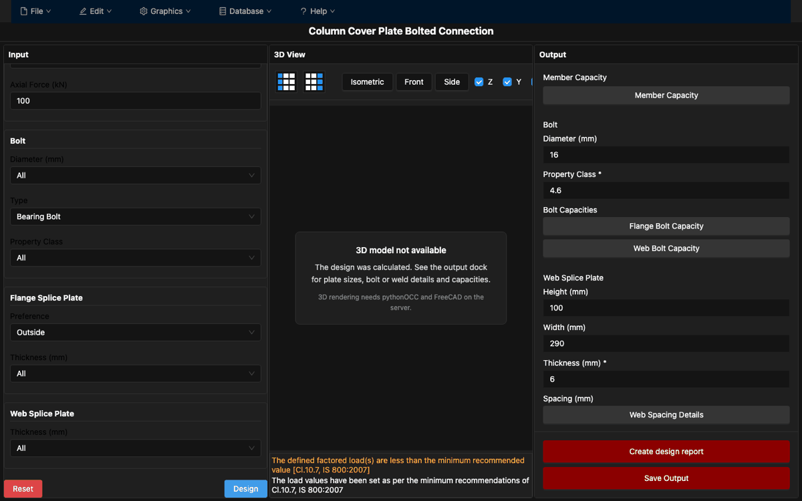
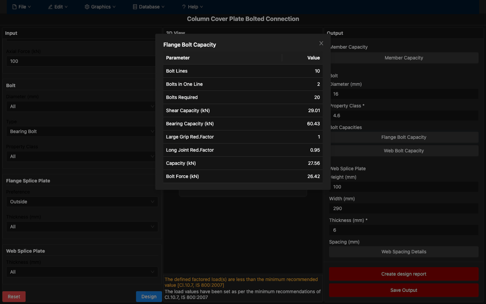

<p align="center">
  <br>
</p>

# Osdag on Cloud: Column Cover Plate Connection (my work)

My work on **[Osdag on Cloud](https://github.com/osdag-admin/Osdag-web)**: adding a *Column-to-Column Cover Plate* connection module (bolted, plus a welded variant) to the web version of Osdag.


> **Credit:** Osdag (Open Steel Design and Graphics) is developed by the **Osdag team at FOSSEE, IIT Bombay** and its contributors. Osdag® and the Osdag logo are registered trademarks of IIT Bombay. This repository is a copy of the upstream [osdag-admin/Osdag-web](https://github.com/osdag-admin/Osdag-web) codebase (the desktop app lives at [osdag-admin/Osdag](https://github.com/osdag-admin/Osdag)), with my changes added on top. Almost all of the code here was written by the upstream contributors. It is **not** an official Osdag release. For the real product, visit [osdag.fossee.in](https://osdag.fossee.in/).

## Overview

Osdag is free/libre, open-source software for designing and detailing steel structures to the Indian Standard **IS 800:2007**. *Osdag on Cloud* is its web edition. It has a Django + Django REST Framework backend wrapping the Osdag design modules, and a React (Vite) frontend with input docks, design-preference dialogs, output docks and a Three.js 3D viewer for the CAD model. Upstream already shipped shear connections: Fin Plate, End Plate, Cleat Angle and Seated Angle.

## What I added

My commits (April 2025) add the **Column Cover Plate** moment-connection module. Later clean-up commits (November 2026) made it run the real design and fixed security issues; they are listed under [Current status](#current-status).

**Backend**
- `osdag_api/modules/column_cover_plate_bolted.py` and `column_cover_plate_welded.py`: API modules that validate input, run the upstream Osdag design classes (`ColumnCoverPlate` / `ColumnCoverPlateWeld`) and format their outputs and design log. Shared logic is in `column_cover_plate_common.py`.
- `osdag/web_api/columncoverplate_outputView.py` (and the welded subclass): `POST /calculate-output/Column-Cover-Plate-Bolted` and `.../Column-Cover-Plate-Welded`
- Session cookies for both modules in `osdag/web_api/session_api.py`, plus registration in `osdag_api/module_finder.py` / `common_defs.py`
- `osdag_api/tests/test_column_cover_plate.py`: unit tests that run the upstream example inputs

**Frontend (`osdagclient/`)**
- `ColumnCoverPlateBolted.jsx` / `ColumnCoverPlateWelded.jsx`: pages for the new module, at routes `/design/:designType/column_cover_plate_bolted` and `/column_cover_plate_welded`
- Reworked section modals for the design preferences (column, connector, bolt, weld, detailing, design), plus the `DesignPreferences` dialog
- Capacity and spacing buttons in the bolted output dock open a table of the matching design values
- `ColumnCoverPlateViewer.jsx` (3D panel status), `ErrorBoundary.jsx` and extra styles in `App.css`

### Screenshots

| Bolted design output | Flange bolt capacity details |
| --- | --- |
|  |  |

### Current status

- **Outputs are real.** The module runs the upstream IS 800:2007 design code (`design_type/connection/column_cover_plate.py` and `column_cover_plate_weld.py`), so plate sizes, bolt and weld details, capacities and the design log are calculated. Unsafe designs are flagged with the design log's errors. The design does not need pythonOCC.
- An earlier commit of mine had replaced `column_cover_plate.py`, `cad/common_logic.py`, `cad/items/notch.py`, `shear_connection_common.py` and the shared `threerender.jsx` with simplified stubs that returned placeholder values. Those files are now restored verbatim from upstream.
- **3D view:** not available for this module in the web app. CAD needs pythonOCC and FreeCAD on the server, and the upstream CAD endpoint (`/design/cad`) only handles the shear-connection sessions. The 3D panel says so instead of showing a model.
- The welded page is still a basic layout. It runs the design and lists the outputs as a table.

## Tech stack

| Layer | Technologies |
|-------|--------------|
| Backend | Python, Django 3.2, Django REST Framework, SimpleJWT, django-cors-headers, psycopg2 |
| Design / CAD | Osdag design modules (IS 800:2007), pythonOCC (optional), FreeCAD, LaTeX design reports |
| Frontend | React 18, Vite, React Router 6, Redux Toolkit, Ant Design, MUI, Three.js (`@react-three/fiber`, `drei`), Axios |
| Database | PostgreSQL |

## Project structure

```
osdag/
├── osdag_web/          # Django project (settings, URLs, DB credentials)
├── osdag/              # Django app: REST views (web_api/), models, URLs
├── osdag_api/          # Layer between Osdag design code and the web API
│   └── modules/        # fin_plate, end_plate, cleat_angle, seated_angle,
│                       # column_cover_plate_bolted, column_cover_plate_welded
├── design_type/        # Osdag design classes (connections, members)
├── cad/                # CAD model generation
├── design_report/      # LaTeX report generation
├── osdagclient/        # React + Vite frontend
│   └── src/components/ # Input docks, modals, output docks, 3D viewer
├── ResourceFiles/      # Section databases, images
├── populate_database.py / update_sequences.py
├── docker-compose.yml / Dockerfile
└── LICENSE             # Osdag licence (LGPL v3)
```

## Getting started

These steps follow the upstream Osdag on Cloud setup and target Ubuntu 20.04 / 22.04.

### Prerequisites

- Python 3 with Conda (the upstream Osdag installer provides an environment that includes pythonOCC)
- Node.js 16+
- PostgreSQL
- FreeCAD and `texlive-latex-extra` (for CAD and PDF reports)

### 1. Database

```sql
-- sudo -u postgres psql
CREATE ROLE <db_user> PASSWORD '<db_password>' SUPERUSER CREATEDB CREATEROLE INHERIT REPLICATION LOGIN;
CREATE DATABASE "postgres_Intg_osdag" WITH OWNER <db_user>;
```

### 2. Configuration

All secrets and environment-specific settings come from environment variables. For local development, copy `.env.example` to `.env` (git-ignored) and fill it in. Real environment variables take precedence.

| Variable | Required | Default | Purpose |
|----------|----------|---------|---------|
| `DJANGO_SECRET_KEY` | yes (unless `DJANGO_DEBUG=True`) | none | Django secret key, also used to sign JWTs. With debug on and no key set, a temporary random key is used. |
| `DJANGO_DEBUG` | no | `False` | Django debug mode |
| `DJANGO_ALLOWED_HOSTS` | no | `127.0.0.1,localhost` | Comma-separated host names |
| `CORS_ALLOWED_ORIGINS` | no | `http://localhost:5173,http://127.0.0.1:5173` | Frontend origins allowed to call the API with cookies |
| `DB_PASSWORD` | yes | none | PostgreSQL password |
| `DB_USER` | no | `postgres` | PostgreSQL user |
| `DB_NAME` | no | `postgres_Intg_osdag` | Database name |
| `DB_HOST` | no | `localhost` | Database host |
| `DB_PORT` | no | `5432` | Database port |
| `DB_ENGINE` | no | `postgresql` | Set to `sqlite` only for quick local checks (`manage.py check`); the section tables are not loaded then |

`osdag_web/postgres_credentials.py` and `osdag_web/secret_key.py` read these variables. They no longer contain any credentials.

### 3. Backend

```bash
git clone https://github.com/VamsiKrishnaThota03/osdag-column-cover-plate.git
cd osdag
cp .env.example .env                 # then edit it
conda activate                       # environment from the Osdag installer
pip install -r requirements.txt
python populate_database.py
python update_sequences.py
python manage.py makemigrations osdag   # osdag/migrations is git-ignored upstream
python manage.py migrate
python manage.py runserver 8000
```

Run the Column Cover Plate tests (no database or pythonOCC needed; `numpy`, `pandas`, `pylatex` and `PyYAML` must be installed):

```bash
python -m unittest discover -s osdag_api/tests -t .
```

### 4. Frontend

```bash
cd osdagclient
npm install
npm run dev                          # http://localhost:5173
```

### Docker (upstream setup)

`docker-compose.yml` defines `backend`, `frontend` and `db` (Postgres 14) services. Both the backend and Postgres read `DB_USER`, `DB_PASSWORD` and `DB_NAME` from `.env`, and the backend uses `DB_HOST=db`. Create `.env` first, then run `docker compose up`. Postgres is published on `127.0.0.1:5432` only.

## API endpoints for this module

| Method | Path | Purpose |
|--------|------|---------|
| `POST` | `/sessions/create` | Body `{"module_id": "Column Cover Plate Bolted"}` (or `... Welded`). Creates a design session and sets its cookie |
| `POST` | `/calculate-output/Column-Cover-Plate-Bolted` | Runs the bolted design. Returns `{data, logs, success, cad_available}`: `200` with results (`success` is `false` for unsafe designs), `400` for invalid input or no session, `422` if the design code cannot handle the inputs (for example, an unknown section) |
| `POST` | `/calculate-output/Column-Cover-Plate-Welded` | Same for the welded variant |

The other endpoints (sessions, design preferences, design report, user accounts, the shear-connection modules) come from upstream. See `osdag/urls.py`.

## Known limitations

- No 3D model or BREP export for the Column Cover Plate modules in the web app (see [Current status](#current-status)). `create_cad_model` follows the upstream desktop CAD path when pythonOCC is installed, but it has not been tested.
- The shear-connection modules (Fin Plate, End Plate, Cleat Angle, Seated Angle) still need pythonOCC on the server, as upstream. Without it, their endpoints return a clear "not available" error.
- The upstream design classes keep their state on the class. Each request uses a separate subclass, and runs are serialised with a lock.
- Not deployed anywhere from this repo. The Docker setup is the upstream one and has not been rebuilt.

## License

Osdag is © Osdag contributors / FOSSEE, IIT Bombay and is released under the **GNU Lesser General Public License v3**. See [LICENSE](LICENSE). My changes are provided under the same licence.

## Links

- Upstream web app: https://github.com/osdag-admin/Osdag-web
- Upstream desktop app: https://github.com/osdag-admin/Osdag
- Osdag website: https://osdag.fossee.in/
- Contributing to Osdag: [CONTRIBUTING.md](CONTRIBUTING.md)
